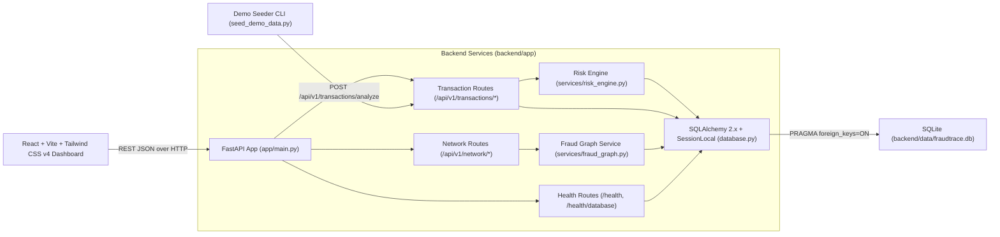
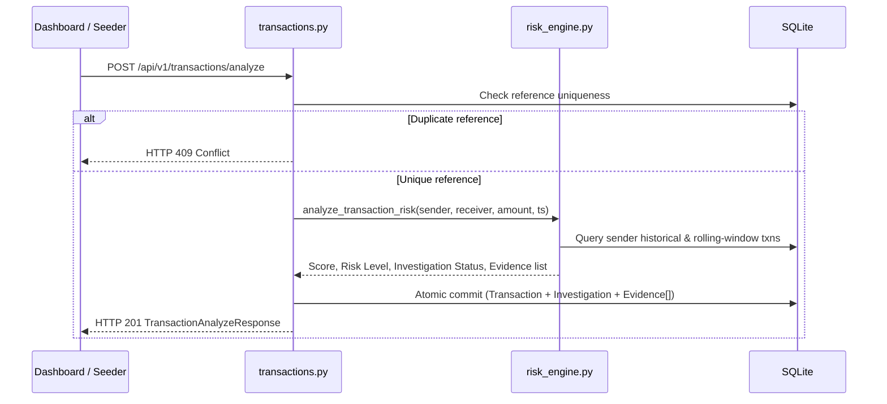

# FraudTrace AI — System Architecture

FraudTrace AI follows a **modular monolithic architecture** separating frontend presentation, FastAPI routing, deterministic fraud evaluation, graph intelligence, and relational SQLite persistence.

---

## High-Level Architecture Diagram

---

## Backend Modules (`backend/app/`)

1. **[`main.py`](../backend/app/main.py)**
   - Configures FastAPI lifespan startup (`init_db()`), CORS middleware (`http://localhost:5173`), health check endpoints (`/health`, `/health/database`), and API routers.
2. **[`database.py`](../backend/app/database.py)**
   - Anchors SQLite paths relative to `backend/` regardless of caller working directory.
   - Enables SQLite foreign-key enforcement (`PRAGMA foreign_keys=ON`) via a SQLAlchemy `Engine` connect listener.
   - Manages request-scoped sessions through `get_db()`.
3. **[`models.py`](../backend/app/models.py)**
   - `Transaction` (`Numeric(18, 2)` amount, unique `reference`, indexed `sender_id` and `receiver_id`, `risk_score`, `risk_level`, `investigation_status`)
   - `Investigation` (`transaction_id` FK with `CASCADE` delete, `status`, `summary`, `priority`)
   - `Evidence` (`investigation_id` FK with `CASCADE` delete, `evidence_type`, `description`, `severity`)
4. **[`schemas.py`](../backend/app/schemas.py)**
   - Pydantic v2 request/response contracts with positive amount checks, whitespace trimming, and ISO 3-letter currency normalization.
5. **Domain Services (`backend/app/services/`)**
   - **[`risk_engine.py`](../backend/app/services/risk_engine.py)**: Runs independent heuristic checks (`TRANSACTION_VELOCITY`, `AMOUNT_ANOMALY`, `NEW_RECIPIENT`, `REPEATED_RECIPIENT_ACTIVITY`), computes `0–100` score, assigns level and investigation status.
   - **[`fraud_graph.py`](../backend/app/services/fraud_graph.py)**: Builds a `networkx.MultiDiGraph` from persisted transactions and executes `detect_high_volume_receivers`, `detect_rapid_fund_movement`, `detect_shared_receivers`, and `get_account_connections`.
6. **API Routes (`backend/app/routes/`)**
   - **[`transactions.py`](../backend/app/routes/transactions.py)**: Transaction ingestion/analysis (`409` on duplicate reference), paginated retrieval, and investigation detail queries.
   - **[`network.py`](../backend/app/routes/network.py)**: Network overview statistics, filtered pattern leads, and 1–2 hop account inspection.

---

## Core Data Flows

### 1. Transaction Analysis Flow (`POST /api/v1/transactions/analyze`)

### 2. Fraud Network Intelligence Flow (`GET /api/v1/network/*`)

1. Route opens read session via `get_db()` and calls `build_transaction_graph(db)`.
2. `Transaction` records are loaded in chronological order into an `nx.MultiDiGraph`, preserving multiple transfers between any `(sender_id, receiver_id)` pair.
3. Requested endpoint runs `detect_all_patterns(graph)` and/or `get_account_connections(graph, account_id, max_hops=2)`.
4. Results return strictly attributed account identifiers, transaction references, timestamps, and cautious lead explanations.

---

## Frontend Architecture (`frontend/src/`)

- **[`services/api.ts`](../frontend/src/services/api.ts)**: Single centralized HTTP layer with `VITE_API_URL` environment configuration (`http://127.0.0.1:8000` fallback) and unified error parsing.
- **[`types/api.ts`](../frontend/src/types/api.ts)**: Strict TypeScript interfaces aligned 1:1 with backend Pydantic models.
- **Dashboard Components (`frontend/src/components/`)**:
  - `HealthStatus.tsx` + `OverviewMetrics.tsx` — Live backend/DB connectivity and KPI cards.
  - `TransactionAnalyzeForm.tsx` + `RecentTransactionsTable.tsx` — Submission, immediate feedback, duplicate protection, and ledger filtering.
  - `InvestigationDetailsPanel.tsx` — Deep evidence inspection and linked network context.
  - `NetworkGraphPanel.tsx` + `NetworkIntelligencePanel.tsx` — Custom SVG directed flow graph, 1–2 hop account inspector, and filterable network pattern cards.
