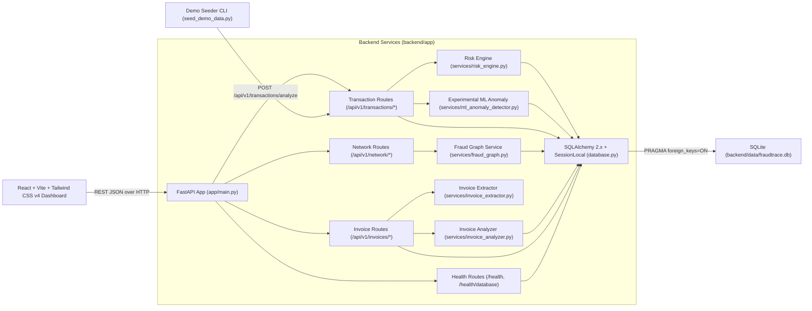
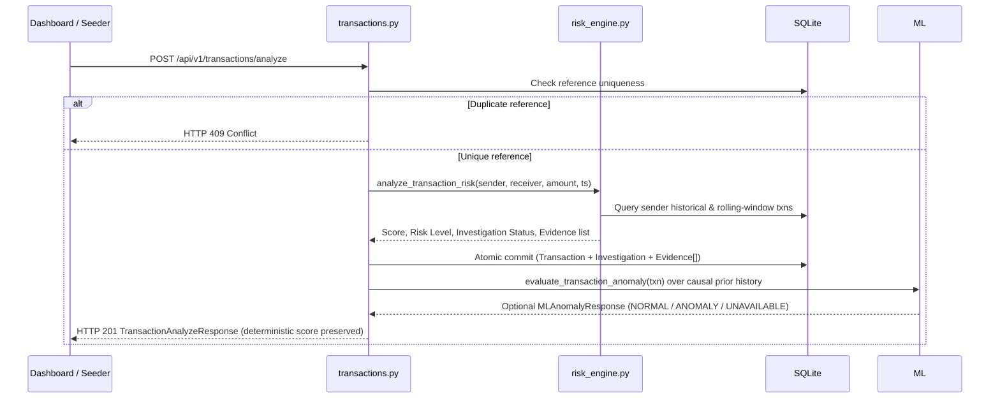

# FraudTrace AI — System Architecture

FraudTrace AI follows a **modular monolithic architecture** separating frontend presentation, FastAPI routing, deterministic fraud evaluation, graph intelligence, and relational SQLite persistence.

---

## High-Level Architecture Diagram

---

## Backend Modules (`backend/app/`)

1. **[`main.py`](../backend/app/main.py)**
   - Configures FastAPI lifespan startup (`init_db()`), CORS middleware (`http://localhost:5173`), health check endpoints (`/health`, `/health/database`), and API routers.
2. **[`database.py`](../backend/app/database.py)**
   - Anchors SQLite paths relative to `backend/` regardless of caller working directory.
   - Enables SQLite foreign-key enforcement (`PRAGMA foreign_keys=ON`) via a SQLAlchemy `Engine` connect listener.
   - Manages request-scoped sessions through `get_db()`.
3. **[`models.py`](../backend/app/models.py)**
   - `Transaction` (`Numeric(18, 2)` amount, unique `reference`, indexed `sender_id` and `receiver_id`, `risk_score`, `risk_level`, `investigation_status`)
   - `Investigation` (`transaction_id` FK with `CASCADE` delete, `status`, `summary`, `priority`)
   - `Evidence` (`investigation_id` FK with `CASCADE` delete, `evidence_type`, `description`, `severity`)
   - `Invoice` (`Numeric(18, 2)` `subtotal`/`tax`/`total_amount`, optional unique `submission_reference`, indexed `normalized_vendor_name` & `normalized_invoice_number`, `extraction_status`, `investigation_status`, serialized extracted/corrected field metadata)
   - `InvoiceFinding` (`invoice_id` FK with `CASCADE` delete, `finding_code`, `severity`, `explanation`, `supporting_values`)
4. **[`schemas.py`](../backend/app/schemas.py)**
   - Pydantic v2 request/response contracts with positive amount checks, whitespace trimming, ISO 3-letter currency normalization, and invoice field/finding response schemas.
5. **Domain Services (`backend/app/services/`)**
   - **[`risk_engine.py`](../backend/app/services/risk_engine.py)**: Runs independent heuristic checks (`TRANSACTION_VELOCITY`, `AMOUNT_ANOMALY`, `NEW_RECIPIENT`, `REPEATED_RECIPIENT_ACTIVITY`), computes `0–100` score, assigns level and investigation status.
   - **[`ml_anomaly_detector.py`](../backend/app/services/ml_anomaly_detector.py)**: Fits a deterministic (`random_state=42`) `StandardScaler` + `IsolationForest` over causal prior transactions (`>= 10` required) to provide optional experimental `decision_function` scores and descriptive z-score feature deviations without modifying deterministic rules.
   - **[`fraud_graph.py`](../backend/app/services/fraud_graph.py)**: Builds a `networkx.MultiDiGraph` from persisted transactions and executes `detect_high_volume_receivers`, `detect_rapid_fund_movement`, `detect_shared_receivers`, and `get_account_connections`.
   - **[`invoice_extractor.py`](../backend/app/services/invoice_extractor.py)**: Validates bounded uploads (`<= 10 MB`), magic-byte signatures, PDF structure (`<= 5` pages, non-encrypted) via `PyMuPDF`, image dimensions/pixels via `Pillow`, probes external Tesseract availability honestly (`OCR_UNAVAILABLE` if absent), parses fields without inventing missing values, and tracks raw extracted values separately from optional user corrections.
   - **[`invoice_analyzer.py`](../backend/app/services/invoice_analyzer.py)**: Executes deterministic rules (`DUPLICATE_INVOICE`, `MISSING_CRITICAL_FIELDS`, `ARITHMETIC_MISMATCH` within `0.02` `Decimal` tolerance, `INVALID_DATE`, `DUE_BEFORE_INVOICE_DATE`, `FUTURE_INVOICE_DATE`, `EXTRACTION_QUALITY`) producing `NO_FINDINGS`, `NEEDS_REVIEW`, or `INCOMPLETE_EXTRACTION`.
6. **API Routes (`backend/app/routes/`)**
   - **[`transactions.py`](../backend/app/routes/transactions.py)**: Transaction ingestion/analysis (`409` on duplicate reference), paginated retrieval, and investigation detail queries.
   - **[`network.py`](../backend/app/routes/network.py)**: Network overview statistics, filtered pattern leads, and 1–2 hop account inspection.
   - **[`invoices.py`](../backend/app/routes/invoices.py)**: Multipart invoice upload investigation (`201`, `400`/`409`/`413`/`415`/`422`), newest-first paginated invoice history, and invoice investigation detail lookup.

---

## Core Data Flows

### 1. Transaction Analysis Flow (`POST /api/v1/transactions/analyze`)

### 2. Fraud Network Intelligence Flow (`GET /api/v1/network/*`)

1. Route opens read session via `get_db()` and calls `build_transaction_graph(db)`.
2. `Transaction` records are loaded in chronological order into an `nx.MultiDiGraph`, preserving multiple transfers between any `(sender_id, receiver_id)` pair.
3. Requested endpoint runs `detect_all_patterns(graph)` and/or `get_account_connections(graph, account_id, max_hops=2)`.
4. Results return strictly attributed account identifiers, transaction references, timestamps, and cautious lead explanations.

### 3. Invoice Investigation Flow (`POST /api/v1/invoices/analyze`)

1. Route verifies optional `submission_reference` uniqueness (`409` on conflict) and parses optional `corrections_json` (`400` on invalid/unknown keys).
2. `read_bounded_upload_sync` caps streaming payload at `10 MB` (`413`), and `extract_invoice_document` validates magic bytes (`415`), PDF structure (`<= 5` pages, non-encrypted via `PyMuPDF`), or image structure (`<= 10,000 px`, `<= 25,000,000` pixels via `Pillow`, `422`).
3. Text is read natively from PDFs or checked against dynamic host `tesseract` availability (reporting `OCR_UNAVAILABLE` cleanly when absent); parsed fields keep `extracted_value`, `corrected_value`, and `effective_value` separated without retaining uploaded file bytes.
4. `analyze_invoice` runs deterministic duplicate, missing-critical-field, `Decimal` arithmetic (`0.02` tolerance), date, and extraction-quality rules, committing `Invoice` and `InvoiceFinding[]` atomically without altering any transaction or ML records.

---

## Frontend Architecture (`frontend/src/`)

- **[`services/api.ts`](../frontend/src/services/api.ts)**: Single centralized HTTP layer with `VITE_API_URL` environment configuration (`http://127.0.0.1:8000` fallback), multipart `FormData` upload handling, and unified error parsing.
- **[`types/api.ts`](../frontend/src/types/api.ts)**: Strict TypeScript interfaces aligned 1:1 with backend Pydantic models.
- **Dashboard Components (`frontend/src/components/`)**:
  - `HealthStatus.tsx` + `OverviewMetrics.tsx` — Live backend/DB connectivity and KPI cards.
  - `TransactionAnalyzeForm.tsx` + `RecentTransactionsTable.tsx` — Submission, immediate feedback, duplicate protection, and ledger filtering.
  - `InvestigationDetailsPanel.tsx` — Deep evidence inspection and linked network context.
  - `MLAnomalyCard.tsx` — Separate experimental IsolationForest panel showing `decision_function` score, non-probability disclaimers, and descriptive statistical deviations.
  - `NetworkGraphPanel.tsx` + `NetworkIntelligencePanel.tsx` — Custom SVG directed flow graph, 1–2 hop account inspector, and filterable network pattern cards.
  - `InvoiceInvestigationPanel.tsx` — **Invoices** workspace tab handling `PDF`/`PNG`/`JPG` upload validation, honest OCR availability status banners, separated extracted vs. user-corrected fields, severity-tagged findings, and persisted invoice history.
